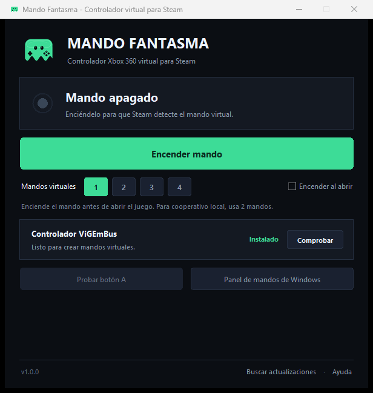

# Mando Fantasma

**Controlador Xbox 360 virtual para Steam, pensado para Darksiders Genesis.**

Mando Fantasma crea uno o varios mandos virtuales con ViGEmBus para que Steam y los juegos detecten un controlador aunque no haya ninguno físico conectado. Incluye el instalador del driver dentro del ejecutable y se actualiza automáticamente desde GitHub Releases.

[](https://github.com/joseestebanmarinrincones-dot/darksiders-phantom-controller/releases/latest)
[](https://github.com/joseestebanmarinrincones-dot/darksiders-phantom-controller/actions/workflows/release.yml)
[](LICENSE)



## Descargar

Ve a **[Releases](https://github.com/joseestebanmarinrincones-dot/darksiders-phantom-controller/releases/latest)** y descarga **`MandoFantasma.exe`**.

- No necesitas instalar Python ni nada más.
- El instalador de ViGEmBus va incluido dentro del `.exe`.
- Funciona en Windows 10 y Windows 11 de 64 bits.

> Windows SmartScreen puede avisar de que el ejecutable no está firmado. Es normal en proyectos independientes: pulsa **Más información → Ejecutar de todas formas**.

## Cómo se usa

1. Abre `MandoFantasma.exe`.
2. En la tarjeta **Controlador ViGEmBus**, pulsa **Instalar** (solo la primera vez). Acepta el aviso de administrador y completa el instalador. Si Windows pide reiniciar, reinicia.
3. Pulsa **Encender mando**. Steam lo verá como un **Xbox 360 Controller**.
4. Abre Steam y después Darksiders Genesis. Si el juego ya estaba abierto, ciérralo y vuelve a abrirlo.
5. Para apagarlo, pulsa **Apagar mando**. También puedes dejarlo encendido todo el tiempo que quieras.

### Cooperativo local

Antes de encender el mando, elige **2 mandos virtuales**. Steam verá dos mandos Xbox 360 y podrás jugar la campaña cooperativa de Darksiders Genesis. Se pueden crear hasta 4.

### Si Steam no lo detecta

- Enciende el mando **antes** de abrir Steam, o reinicia Steam con el mando ya encendido.
- Pulsa **Panel de mandos de Windows** y comprueba que aparece el mando.
- Si acabas de instalar ViGEmBus, reinicia Windows.
- En Steam, revisa **Configuración → Controlador** y asegúrate de que la detección de mandos esté activada.

## Actualizaciones automáticas

Cada vez que abras el programa, consulta la última release de este repositorio. Si hay una versión nueva:

- Muestra un aviso con las notas de la versión.
- El botón **Actualizar** descarga el nuevo `.exe`, comprueba su integridad y lo reemplaza automáticamente al cerrar el programa.
- Tus ajustes se guardan en `%APPDATA%\MandoFantasma\config.json` y se conservan entre versiones.

También puedes pulsar **Buscar actualizaciones** en el pie de la ventana.

## Para el desarrollador

### Compilar en local

Requisitos: Windows 10/11 x64, Python 3.12 y conexión a internet la primera vez (para descargar el instalador de ViGEmBus).

```powershell
python -m venv .venv
.\.venv\Scripts\Activate.ps1
pip install -r requirements.txt
python build.py
```

El resultado queda en `dist\MandoFantasma.exe`. El script descarga el instalador oficial de ViGEmBus 1.22.0, verifica su SHA256 y genera un ejecutable único con icono y metadatos.

Para regenerar el icono (opcional, requiere Pillow):

```powershell
pip install -r requirements-dev.txt
python tools\make_icon.py
```

### Publicar una actualización

El repositorio incluye un workflow de GitHub Actions que compila y publica la release automáticamente al subir un tag `v*`.

1. Haz tus cambios y actualiza la versión en `version.txt` (por ejemplo, `1.1.0`).
2. Haz commit y push a `main`.
3. Crea y sube el tag:

```powershell
git add .
git commit -m "Nueva versión 1.1.0"
git push
git tag v1.1.0
git push origin v1.1.0
```

El workflow **Compilar y publicar release** comprueba que el tag coincide con `version.txt`, compila `MandoFantasma.exe` y lo adjunta a la release. La app de tu amigo mostrará el aviso de actualización la próxima vez que la abra.

> No cambies el nombre del asset. La app busca un archivo llamado exactamente `MandoFantasma.exe` dentro de la última release.

Si prefieres publicar manualmente, ejecuta `python build.py` y adjunta `dist\MandoFantasma.exe` a una release con tag `vX.Y.Z`.

## Estructura

```text
app.py                      Programa principal (interfaz, mando virtual y autoactualización)
build.py                    Compilación con PyInstaller
version.txt                 Versión actual (X.Y.Z)
assets/                     Iconos de la app y del ejecutable
tools/make_icon.py          Generador del icono
vendor/                     Instalador y licencias de ViGEmBus (el .exe se descarga al compilar)
.github/workflows/          Compilación y publicación automática de releases
```

## Notas

- Mando Fantasma no está afiliado a Valve, Steam, THQ Nordic ni Nefarius Software Solutions.
- ViGEmBus es un controlador de Windows firmado digitalmente y de código abierto. Se instala una sola vez.
- El programa no incluye ni modifica Darksiders Genesis; solo pone a disposición del sistema un mando virtual estándar.
- El ejecutable es un build de Python con PyInstaller y no está firmado digitalmente, por eso SmartScreen puede pedir confirmación la primera vez.

## Créditos

- [ViGEmBus](https://github.com/nefarius/ViGEmBus), de Nefarius Software Solutions e.U. (BSD-3-Clause).
- [vgamepad](https://github.com/yannbouteiller/vgamepad), de Yann Bouteiller (MIT).
- Python, tkinter y PyInstaller.

Consulta [THIRD_PARTY_NOTICES.md](THIRD_PARTY_NOTICES.md) para los textos completos de las licencias.

## Licencia

Este proyecto se distribuye bajo la licencia MIT. Consulta [LICENSE](LICENSE).
